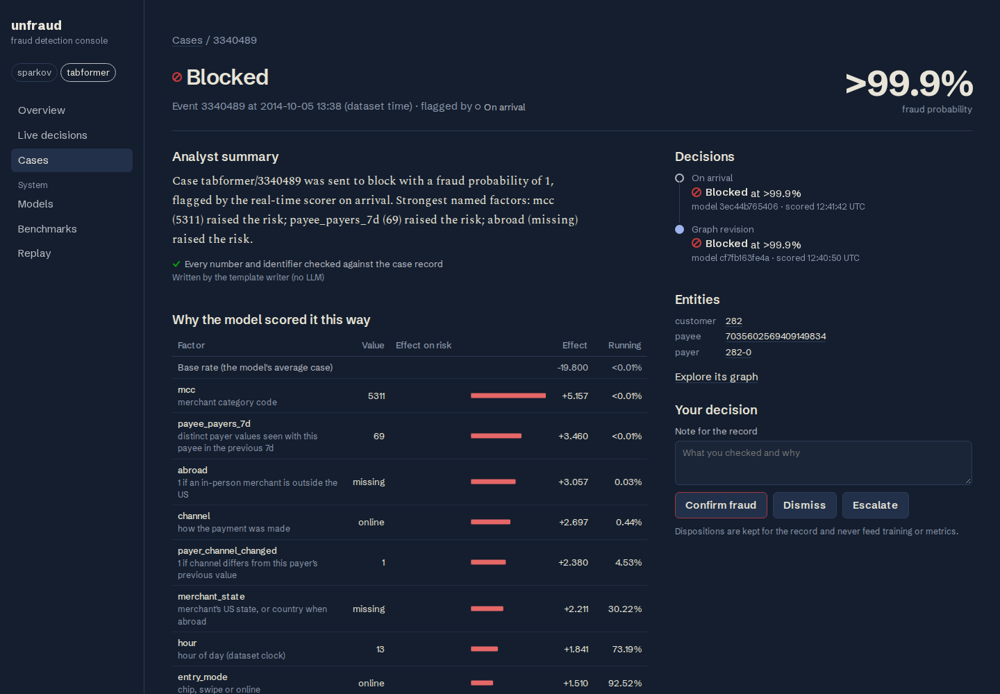

# unfraud

A real-time fraud detection engine that runs on a laptop. Payments stream through Kafka into a Go scorer that combines real-time features, fast rules and a LightGBM model; a single-writer graph service links payers that pay the same payees and revises decisions with graph features; flagged events become cases with TreeSHAP explanations and grounded LLM summaries; a Next.js console shows it all. Everything runs on local Kubernetes, and every number below is regenerated from public datasets by the commands in this repository.

Three public datasets, with every column named, are normalized into one Payment Schema: [IBM TabFormer](https://github.com/IBM/TabFormer) card payments, [Sparkov](https://www.kaggle.com/datasets/kartik2112/fraud-detection) card payments and [IBM AMLworld](https://arxiv.org/abs/2306.16424) bank transfers (laundering stands in for fraud). All three are simulations ([ADR-0018](docs/adr/0018-named-payment-datasets.md)).

- Design: [`docs/design.md`](docs/design.md) · decisions: [`docs/adr/`](docs/adr) · vocabulary: [`CONTEXT.md`](CONTEXT.md)
- Results: [`results/tabformer-lightgbm.md`](results/tabformer-lightgbm.md), [`results/sparkov-lightgbm.md`](results/sparkov-lightgbm.md), [`results/amlworld-lightgbm.md`](results/amlworld-lightgbm.md), [`results/pooled-core.md`](results/pooled-core.md)



More: [overview](docs/screenshots/overview.png) · [case queue](docs/screenshots/cases.png) · [graph explorer](docs/screenshots/graph.png) · [benchmarks](docs/screenshots/benchmarks.png)

## Results

Test PR-AUC per dataset (time splits; thresholds always set on the validation period):

| Model | TabFormer (2019, 0.12% fraud) | Sparkov (Jul–Dec 2020, 0.38%) | AMLworld (9–10 Sep, 0.11%) |
|---|---|---|---|
| Raw features (core + the dataset's named extras) | 0.457 | 0.794 | 0.082 |
| + real-time features | **0.763** | 0.940 | **0.512** |
| + graph features | 0.346 | – | 0.488 |
| Core features only | 0.017 | **0.952** | 0.493 |

- Real-time features (payer and payee velocity, unusual amounts, new payees) are what work on every dataset. At an Alert Budget of 0.5% of Events, the served models catch 91% of TabFormer fraud and 79% of Sparkov fraud. On AMLworld they catch 71% of laundering, but the threshold set on the validation days flags 1.15% of test transfers, not 0.5%.
- Graph features did not survive the test period. On TabFormer they hurt on validation too; on AMLworld they helped on validation (0.618 vs 0.563) and then lost on test. Component sizes grow with the simulated population, and the model learns thresholds that stop holding.
- Hand-written rules rarely earn their place. A rule stays only if it is at least as precise on validation as the model's own top 2% of alerts: one of six survives on TabFormer and AMLworld ("this payee recently received confirmed fraud", 18–21% precision), none on Sparkov. Prior fraud on a payer, the classic rule, predicts nothing in Sparkov (each card has one fraud episode) and fires on a tenth of AMLworld's traffic (hub accounts).

**One model across datasets.** Every dataset is read into the same core features, so a Core Model trained on one can score another unchanged:

| Trained on | TabFormer | Sparkov | AMLworld |
|---|---|---|---|
| TabFormer | 0.017 | *0.006* | *0.002* |
| Sparkov | *0.001* | **0.952** | *0.001* |
| AMLworld | *0.003* | *0.006* | **0.493** |
| TabFormer + Sparkov, pooled | 0.011 | 0.936 | *0.005* |
| All three, pooled | 0.012 | 0.926 | 0.476 |
| Guessing (the fraud rate) | 0.001 | 0.004 | 0.001 |

Test PR-AUC; italic cells are datasets the model never saw. Nothing transfers: a model trained on one simulator scores at chance on the others, because each hides fraud somewhere else (TabFormer in particular merchant codes and abroad, Sparkov in online shopping and groceries at night, AMLworld in fan-in and fan-out transfer patterns). Pooling all three costs each dataset a little and gains nothing. The pooled model still runs: it binds to any payment Profile by feature name, and Go reproduces its Python scores exactly.

**The running system** (4-core, 8 GB laptop, `lite` profile):

- Go scores equal Python LightGBM exactly on every dataset's test period, including the pooled model scoring Sparkov through Sparkov's own schema; Go TreeSHAP matches LightGBM's to 1e-9.
- Sparkov end to end in the cluster: one scorer pod scored all 1,852,394 Events at 482 a second from a backlog. 98.6% of probabilities are bit-identical to the offline Accuracy Run, and 102 Decisions differ (partitions running in parallel against shared feature state).
- TabFormer runs its scorer and graph-svc in the cluster (the screenshots); AMLworld's feature state does not fit the `lite` memory budget, so its numbers are offline only.

## Run it

Requirements: Linux or macOS with Docker and about 5 GB of free RAM; Go 1.27, buf, kind, kubectl, Helm 4, Node 24 with pnpm, uv, jq; a Kaggle API token in `~/.kaggle/`.

```sh
make data                              # download (~3.5 GB), normalize into events.csv, verify checksums
make cluster-up deploy images          # kind + Strimzi + CloudNativePG; Kafka, Valkey, Postgres, console

# Train (outside the cluster; stop it first on an 8 GB machine)
make featurize PROFILE=amlworld        # Accuracy Run -> training tables
make train PROFILE=amlworld            # core, raw, real-time and graph models
make pooled                            # pooled Core Models and cross-dataset scoring (all three featurized)
make parity PROFILE=amlworld           # Go scores must equal Python's

# Serve
make deploy-model PROFILE=amlworld MODEL=lgbm-realtime             # the scorer
make deploy-model PROFILE=amlworld MODEL=lgbm-graph SERVICE=graph  # graph-svc
make replay PROFILE=amlworld                                        # stream the dataset

make console                           # http://localhost:3000
make grafana                           # http://localhost:3001
make tailscale                         # or serve both on this machine's Tailscale IP, across reboots
```

Summaries use a template writer unless you add an OpenRouter key: put it in `~/.config/unfraud/openrouter_key`, run `make secrets`, and deploy with `--set summarizer.driver=openrouter`. `scripts/summary-report.sh` then reports grounding rate, latency and cost per model. `make help` lists every target.

## What it does not do

- The data is simulated. The metrics say how well the engine finds each simulator's fraud, not how it would do on a real bank's traffic, and the simulators make some of it easy (73% of TabFormer's transactions in Italy are fraud).
- No Entity appears in two datasets, so the graph never links across them. Across datasets means shared features and models that transfer.
- Memory: AMLworld's Accuracy Run peaks at 5.1 GB, because feature state for 500,000 accounts is held in memory. Training and featurizing need the cluster stopped on an 8 GB machine.
- It is local-only: no authentication, one Kafka broker, one replica per service. KEDA autoscaling, a hot-standby graph service and tracing are designed but not built, because they could not be validated on the reference machine.
- PaySim is used for load testing only; its balance columns give away the label.
- Real-LLM summary quality has not been measured yet (no key was available while building); the grounding check and the reporting are in place.
